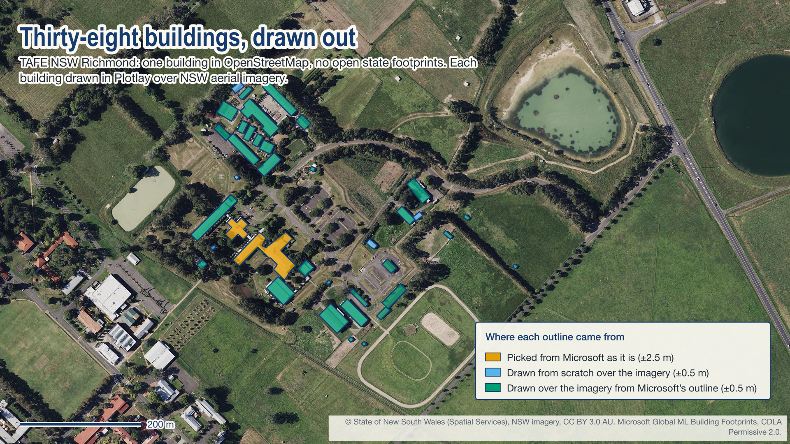
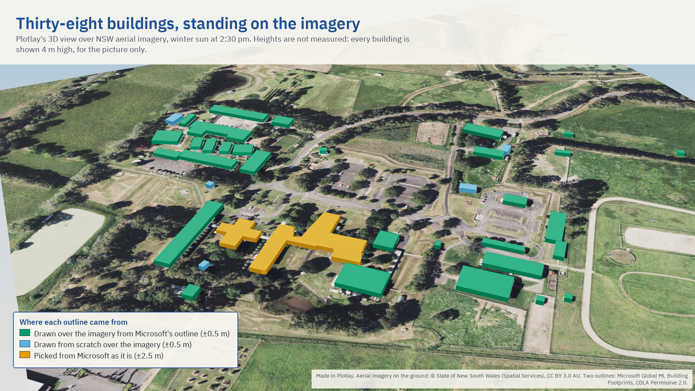
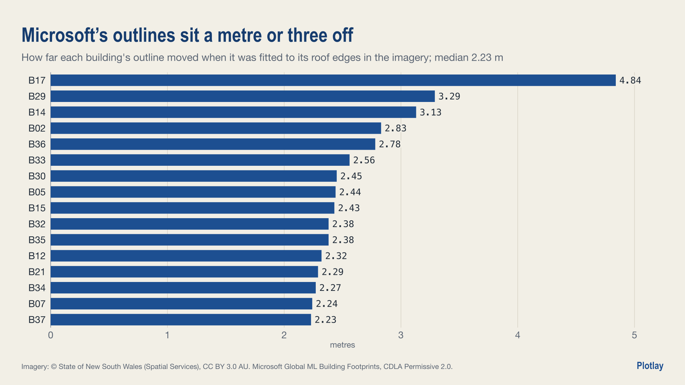
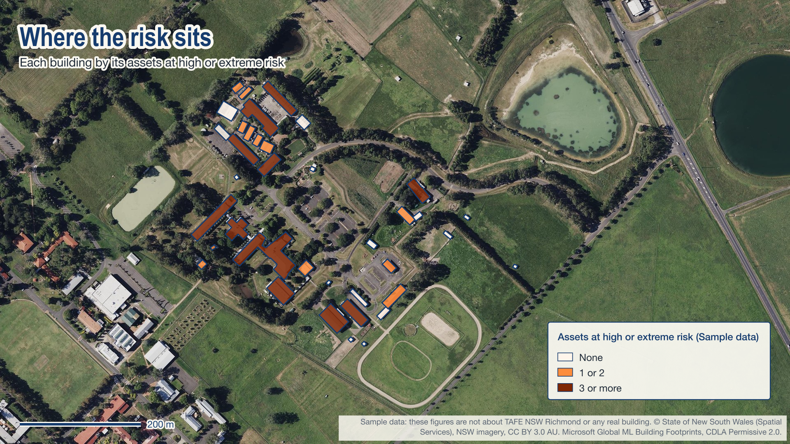
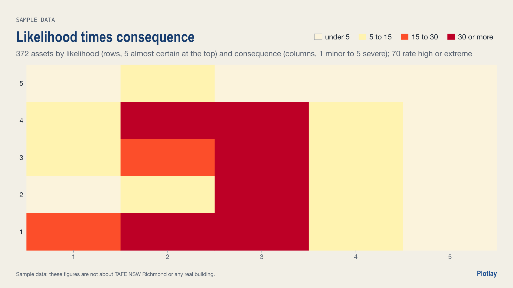
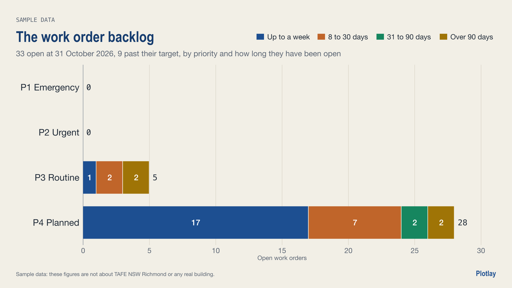
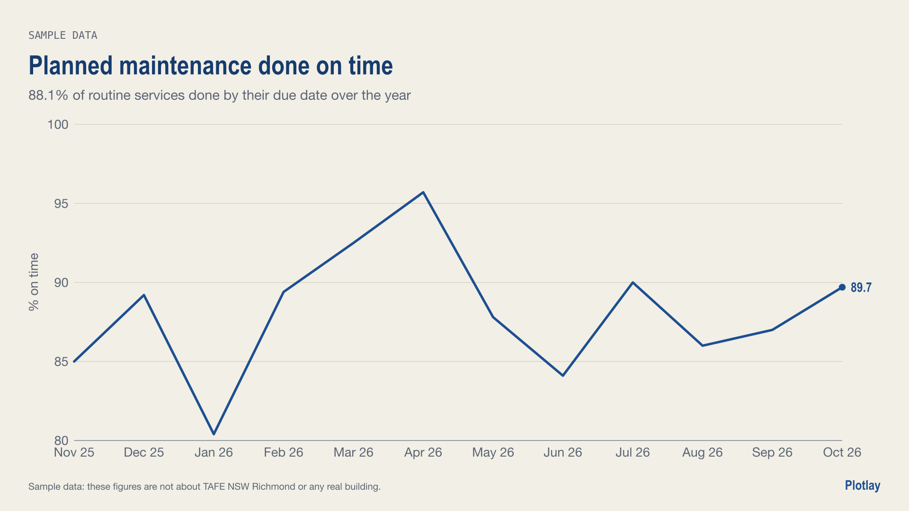
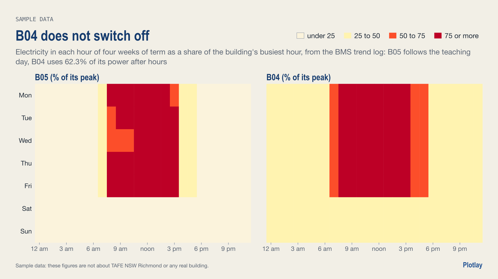

# A campus drawn out, building by building

**What if a campus's buildings are in no map data at all? Draw them out over open aerial imagery, record where each outline came from and how accurate it is, then key the asset outcomes to each one.**

TAFE NSW Richmond, on the Hawkesbury flood plain west of Sydney. **Live version, with an interactive map:** [getplotlay.com/showcase/tafe-richmond](https://www.getplotlay.com/showcase/tafe-richmond/)

OpenStreetMap has 1 building inside the campus. NSW's building footprint layer is licensed to government agencies only. The land title is a 292 ha lot shared with the university next door, so there is no parcel to start from. Microsoft's building outlines, made by software from aerial photos, find 33 shapes, which miss 5 buildings and sit a median 2.23 m off the roofs. In [Plotlay](https://www.getplotlay.com) all 38 buildings were drawn out over NSW aerial imagery (CC BY 3.0 AU), and each carries where its outline came from and how accurate it is likely to be.

## Where each outline came from

| Outline source | Buildings | Accuracy |
|---|---|---|
| Traced over NSW Imagery (not in the Microsoft footprints) | 5 | ±0.5 m |
| Traced over NSW Imagery, started from the Microsoft footprint and fitted to the roof edges | 31 | ±0.5 m |
| Microsoft footprint, picked as it is (a complex roof, not refined) | 2 | ±2.5 m |

Accuracy depends on the imagery: a roof outline includes the eaves, and a shadow or a tree over an edge can hide it. These are what the drawing method can hold to; where law or a contract needs a licensed surveyor, their licence and sign-off are what count.

### How it was drawn

1. **A map project on NSW aerial imagery** in Plotlay (allowed in exports).
2. **Campus site**: a one-row table linked to an empty data layer, its key placed by drawing the campus along its fences and roads (no lot of its own).
3. **Buildings**: the 38-row table linked, then each row placed by drawing its corners over the imagery with Square corners as I draw on (the campus grid runs about 42 degrees off east). Where Microsoft's outline existed it was the starting point and the corners went onto the roof edges; where it did not, the building was drawn from scratch. Two complex roofs were picked from Microsoft's footprints as they are. Every shape keeps its source.
4. **Roll up** the buildings to the site, and **export** GeoJSON, TopoJSON for the Power BI Shape Map, CSV with WKT and a Python starter.

## Sample data: asset outcomes, building by building

`data/sample/` is sample data: the figures are not about TAFE NSW Richmond or any real building. It shows what a facilities team links once each building is a keyed shape: an asset register of 372 assets as points inside the buildings, risk as likelihood times consequence, twelve months of work orders, planned maintenance, essential safety measures, an asbestos register, a BMS trend log of the building meters, space use and a capital works backlog. In the sample, 70 assets rate high or extreme, 33 work orders are open (9 overdue), 88.1% of planned maintenance was done on time, and the backlog is A$3.1M. It was drawn from one fixed seed with the same generator as the [University High School showcase](https://www.getplotlay.com/showcase/school-campus/); [`data/sample/README.md`](data/sample/README.md) is the data dictionary. `data/sample/handover/` is the building handover pack Plotlay makes from it (COBie, IFC, Project Haystack, Brick), with no rooms drawn. No real figure uses it.

| | |
|---|---|
|  |  |
|  |  |

The charts and map pictures were drawn with Plotlay's own chart engine (the Analysis page).

## What's here

| Folder | What |
|---|---|
| [`data/geometry/`](data/geometry) | The buildings (keys B01 to B38) and the campus (key RICH) as drawn in Plotlay: GeoJSON, TopoJSON, CSV with WKT |
| [`data/buildings/`](data/buildings) | `buildings.csv`: each building's outline source, accuracy, footprint, perimeter, and how far Microsoft's footprint was off |
| [`data/site/`](data/site) | `site.csv` and `site_rollup.csv` (the buildings rolled up in Plotlay) |
| [`data/sample/`](data/sample) | **Sample data**: eleven facilities tables, the data dictionary, the handover pack |
| [`python/`](python) | `tafe_richmond.ipynb`, executed |
| [`powerbi/`](powerbi) | `TafeRichmondBuildings.pbip`: open [`OPEN-ME.md`](powerbi/OPEN-ME.md) first |
| [`visuals/`](visuals) | The hero map, the charts and the sample map, 16:9 and 1:1 |

## Sources and licence

Code (the notebook, the Power BI project): MIT ([`LICENSE`](LICENSE)). Data we made (the shapes and tables): CC BY 4.0 ([`LICENSE-DATA`](LICENSE-DATA)). Upstream: NSW Imagery, © State of New South Wales (Spatial Services, a business unit of the Department of Customer Service NSW), CC BY 3.0 AU; Microsoft Global ML Building Footprints, CDLA Permissive 2.0. Full credits in [`NOTICE`](NOTICE). Nothing here implies endorsement by TAFE NSW or Spatial Services.

Made with [Plotlay](https://www.getplotlay.com): maps, plans and data layers for Power BI and Python.

## The other campus and schools showcases

- [One school campus, building by building](https://www.getplotlay.com/showcase/school-campus/): University High School, Parkville, where the buildings were already in the council's footprints.
- [Sydney schools](https://www.getplotlay.com/showcase/sydney-schools/): grounds per student across 81 inner Sydney and Parramatta government schools.
